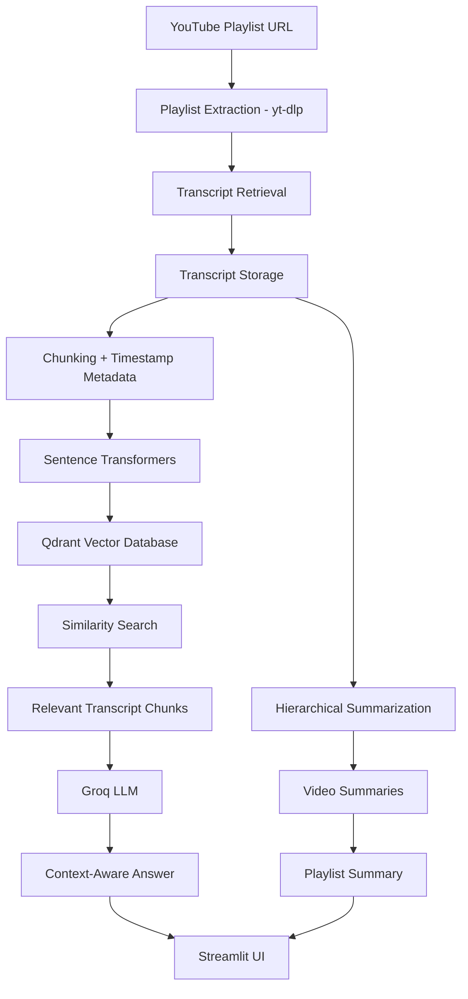

# PlaylistIQ 🎬

**Turn YouTube playlists into searchable learning resources.**

PlaylistIQ is a YouTube Playlist Summarizer and RAG-based Learning Assistant. It processes videos from a YouTube playlist, extracts their transcripts, generates individual and playlist-level summaries, and lets users ask questions about the playlist content.

Instead of manually watching or searching through hours of videos, users can explore the key concepts and retrieve context-aware answers with links to the relevant video timestamps.

## ✨ Features

- **Playlist Processing:** Extracts video information from a YouTube playlist.
- **Transcript Extraction:** Retrieves available video transcripts.
- **Intelligent Chunking:** Splits transcripts into manageable chunks while preserving timestamp metadata.
- **Semantic Search:** Generates embeddings and stores them in Qdrant for similarity-based retrieval.
- **RAG-based Question Answering:** Answers questions using relevant transcript chunks as context.
- **Video Summaries:** Generates summaries for individual videos using hierarchical summarization.
- **Playlist Summary:** Combines individual video summaries into an overall playlist summary.
- **Timestamp References:** Provides YouTube links to relevant sections of videos.
- **Interactive UI:** A Streamlit interface for processing playlists, viewing summaries, and asking questions.

## 🧠 How It Works

PlaylistIQ uses a Retrieval-Augmented Generation (RAG) pipeline.

### Architecture



### RAG Pipeline

1. The user provides a YouTube playlist URL.
2. Playlist metadata and video information are extracted.
3. Available transcripts are retrieved and saved locally.
4. Transcripts are divided into chunks with overlap.
5. Each chunk is converted into a vector embedding.
6. Embeddings and associated metadata are stored in Qdrant.
7. When a user asks a question, it is converted into an embedding.
8. Qdrant retrieves the most relevant transcript chunks.
9. The retrieved context is passed to the Groq LLM.
10. The LLM generates an answer grounded in the retrieved content, with relevant video timestamp links.

### Summarization Pipeline

PlaylistIQ also uses hierarchical summarization to handle longer transcripts.

- Transcript chunks are summarized in batches.
- Batch summaries are combined into larger summaries.
- A final summary is generated for each video.
- Individual video summaries are combined into a playlist-level summary.

This approach avoids sending an entire long transcript in a single LLM request.

## 🛠️ Tech Stack

| Component | Technology |
|---|---|
| Language | Python |
| UI | Streamlit |
| Playlist Extraction | yt-dlp |
| Transcript Retrieval | youtube-transcript-api |
| Embedding Model | sentence-transformers/all-MiniLM-L6-v2 |
| Vector Database | Qdrant |
| LLM Provider | Groq |
| LLM Model | openai/gpt-oss-120b |
| Dependency Management | uv |

## 📁 Project Structure

```text
youtube-rag/
│
├── app.py
├── main.py
├── ingest.py
│
├── youtube_rag/
│   ├── __init__.py
│   ├── config.py
│   ├── transcript.py
│   ├── chunking.py
│   ├── embeddings.py
│   ├── vector_store.py
│   ├── ingestion.py
│   ├── rag.py
│   └── summarizer.py
│
├── data/
│   ├── transcripts/
│   └── summaries/
│
├── qdrant_data/
│
├── .env
└── pyproject.toml
```

## ⚙️ Getting Started

### Prerequisites

- Python
- [uv](https://docs.astral.sh/uv/)
- A Groq API key

### 1. Clone the repository

```bash
git clone https://github.com/YOUR_USERNAME/youtube-rag.git
cd youtube-rag
```

### 2. Install dependencies

```bash
uv sync
```

### 3. Configure environment variables

Create a `.env` file in the project root:

```env
GROQ_API_KEY=your_groq_api_key
```

Never commit your `.env` file or expose your API key.

### 4. Run the application

```bash
uv run streamlit run app.py
```

Open the local URL displayed in your terminal.

## 🚀 Using PlaylistIQ

1. Open the application.
2. Paste a YouTube playlist URL.
3. Start playlist processing.
4. Explore the overall playlist summary.
5. Browse individual video summaries.
6. Ask questions about the playlist.
7. Follow the source links to jump to relevant video timestamps.

## 💡 Engineering Concepts Explored

Building PlaylistIQ involved working with:

- Retrieval-Augmented Generation (RAG)
- Text chunking and overlap strategies
- Text embeddings and semantic similarity
- Vector databases and metadata payloads
- Context-grounded LLM generation
- Hierarchical summarization
- API integration and rate-limit handling
- Modular Python application design

## ⚠️ Limitations

- Transcripts must be available and accessible for a video to be processed.
- YouTube transcript retrieval may be affected by availability restrictions or IP-based blocking.
- LLM requests are subject to provider rate limits.
- The current implementation uses local Qdrant storage.
- The quality of generated answers depends on transcript quality and retrieval relevance.

## 🔮 Future Improvements

- Better retrieval through reranking and hybrid search.
- Support for additional transcript languages.
- More robust transcript extraction and retry handling.
- Persistent playlist management.
- Improved evaluation of retrieval and answer quality.
- Deployment with hosted vector storage.

## 👨‍💻 Author

**Ishu Singh**

Built as a hands-on project to explore practical AI engineering, RAG systems, vector search, and LLM-powered applications.

